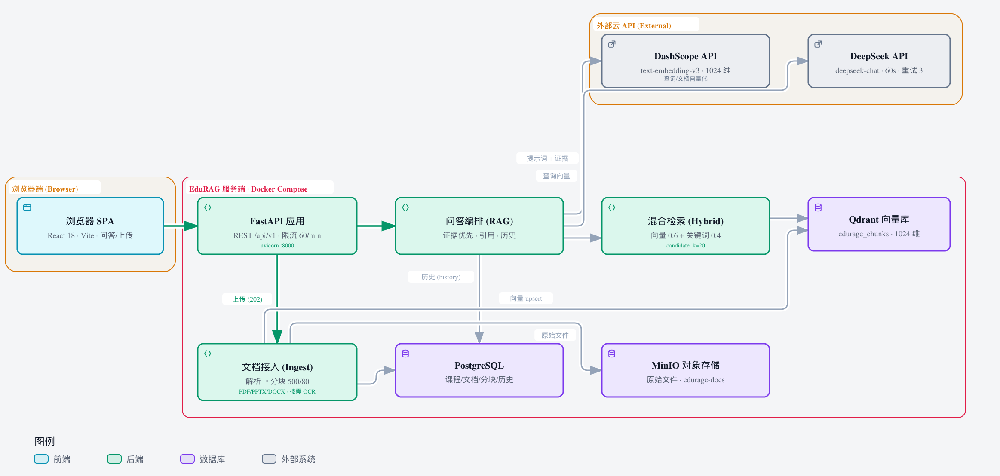

<h1 align="center">EduRAG</h1>

<p align="center">
  <strong>面向高校实验课的课程级 RAG 教学助手</strong><br/>
  上传课件 → 混合检索 → 流式、带页码引用的 Markdown / LaTeX 回答
</p>

<p align="center">
  <a href="https://github.com/scoffee16/EduRAG/actions/workflows/ci.yml"></a>
  <a href="LICENSE"></a>
  
  
</p>

## 简介

EduRAG 是一个**可自托管的课程级 RAG 问答系统**：把 PDF / PPTX / DOCX 课件导入某一门课程后，学生可以用自然语言提问；系统先在该课程资料中做**向量 + 关键词混合检索**，再生成带**页码 / 幻灯片 / 章节**引用的 Markdown / LaTeX 回答。

回答优先来自课程资料；当课程资料检索不到相关片段时，按「Bing 网页搜索 → 模型通用知识」降级，并显式标注来源。适合课程组资料助手、实验课答疑与私有课件检索。

## 特性

- **课程域隔离**：资料按课程归属，提问可限定课程或若干文档。
- **混合检索**：Qdrant 向量召回 + 关键词打分（标识符 / 中文 n-gram），加权 RRF 融合后确定性重排。
- **可核验引用**：按「文档 + 页码 / 幻灯片 / 章节」去重，附原文片段、模态、OCR 与图注来源信息。
- **结构感知解析**：PDF / PPTX / DOCX 按页、幻灯片、标题层级解析；扫描版 PDF 可选择开启 Tesseract OCR。
- **VLM 图表理解**：图片占比高、文本少的 PDF 页面可交给多模态模型生成结构化描述，作为独立 `figure` 块参与检索与引用（默认关闭）。
- **流式回答 + 分段耗时**：SSE 逐 token 返回，前端边收边渲染；`timings` 返回检索 / 首字 / 生成各阶段耗时并写入查询历史。
- **证据上下文预算**：注入 Prompt 的片段按相关性前缀受字符预算约束，超出预算的命中记入 `dropped_hits`。
- **异步导入**：上传立即返回 `202`，前端轮询展示 `parse → chunk → embed → store` 进度。
- **来源分层**：课程资料 / 网页搜索 / 模型通用知识，回答中固定标注。
- **完整生命周期**：文档与课程的创建、删除与级联清理，查询历史持久化。
- **开箱即用**：Docker Compose 一键启动 API、PostgreSQL、Qdrant 与 MinIO。

## 架构



React 18 + Vite 前端 → FastAPI `/api/v1` → 导入管线 / 混合检索 / 引用生成；数据落在 Qdrant（向量）、PostgreSQL（元数据与历史）、MinIO（原始文件），模型调用 DeepSeek Chat 与 DashScope `text-embedding-v3`，图表理解可选接入 OpenAI-compatible 视觉模型（如 Qwen-VL）。

> 可交互版本（缩放 / 深浅色）：[architecture.html](docs/assets/edurage-architecture.html) · 问答链路图：[rag-flow.png](docs/assets/edurage-rag-flow.png)

## 快速开始

**前置条件**：Docker + Docker Compose v2、Node.js 20+、DeepSeek 与 DashScope API Key。

```powershell
git clone https://github.com/scoffee16/EduRAG.git
cd EduRAG
Copy-Item .env.example .env    # 填入两个 API Key，并设置 EDURAGE_ALLOW_CLOUD_UPLOAD=true
docker compose up -d --build   # API :8000 + PostgreSQL + Qdrant + MinIO
```

```powershell
cd frontend
npm install
npm run dev                    # http://localhost:5173
```

- API 文档：<http://127.0.0.1:8000/docs>；健康检查：`curl.exe http://127.0.0.1:8000/api/v1/health`
- Windows 也可双击 `start_edurage.bat` 一键启动（首次使用前同样需要配置 `.env`）
- 本地开发（不用容器跑 API）：见 [docs/development.md](docs/development.md)

## 配置

运行时配置全部通过 `EDURAGE_*` 环境变量提供，共 52 项，完整清单见 [.env.example](.env.example)。最常改的几项：

| 变量 | 说明 |
| --- | --- |
| `EDURAGE_LLM_API_KEY` / `EDURAGE_EMBEDDING_API_KEY` | 必填：DeepSeek 对话 + DashScope 向量 |
| `EDURAGE_ALLOW_CLOUD_UPLOAD` | 上传开关，默认 `false`；改为 `true` 表示允许课件发往云 API |
| `EDURAGE_LLM_MODEL` / `EDURAGE_EMBEDDING_MODEL` | 模型名，默认 `deepseek-chat` / `text-embedding-v3` |
| `EDURAGE_OCR_ENABLED` | 扫描版 PDF OCR，默认关闭（需本机 Tesseract） |
| `EDURAGE_CONTEXT_MAX_CHARS` | 注入 Prompt 的证据字符预算，默认 `4000` |
| `EDURAGE_VLM_ENABLED` / `EDURAGE_VLM_MODEL` | 图片页图表理解开关与视觉模型名，默认关闭 |
| `EDURAGE_API_RATE_LIMIT_PER_MINUTE` / `EDURAGE_API_MAX_CONCURRENCY` | 单进程限流与并发（默认 60/min、2） |

> `.env` 已被 `.gitignore` 忽略，不会提交。Compose 会为 API 注入容器内部服务地址；`.env.example` 中的存储地址面向宿主机本地开发。

## API

接口统一以 `/api/v1` 为前缀，错误响应为 `{"error":{"code","message"},"request_id"}`：

- `POST /upload` 上传课件（异步）、`GET /documents` / `DELETE /documents/{id}` 文档管理
- `POST /query` 课程范围内问答（JSON，返回分段 `timings`）
- `POST /query/stream` 同一请求体的 SSE 流式问答（`meta` / `token` / `done` / `error` 事件）
- `GET /history` 查询历史（含每条记录的 `timings` 快照）
- `GET /courses` / `POST /courses` / `DELETE /courses/{code}` 课程管理
- `GET /health` / `GET /health/ocr` 健康检查

完整字段、错误码与限制见 [docs/ed-04-api.md](docs/ed-04-api.md)。

## 测试与评估

```powershell
python -m pip install -e ".[dev]"
python -m pytest -q                  # 394 项后端测试（离线、无网络）
python -m ruff check .
cd frontend; npm install; npm test   # 37 项前端测试
```

检索评估有两层：**离线融合回归**（8 题 golden set，确定性、不调外部 API）与**真实课件评测**（40 题、标注 gold page，调用真实 embedding/LLM）：

```powershell
python -m scripts.evaluate_retrieval --mode both      # 离线：Recall@5 0.625 → 1.000，MRR 0.531 → 0.906
python -m scripts.evaluate_courseware --mode both     # 真实语料：向量-only vs 混合检索对照
python -m scripts.evaluate_answers --limit 20         # 生成层：faithfulness / 引用覆盖率（LLM judge）
python -m scripts.evaluate_figures --mode both        # VLM 图表：figure_recall@5 / figure 页准确率
```

真实课件评测当前结果（40 题，page-level gold）：纯向量 Recall@5 `0.975`、MRR `0.724`；混合检索 Recall@5 `0.750`、MRR `0.652`——**这是一个如实的负结果**：OCR 课件页上关键词/RRF/确定性重排没有超过纯向量，原因与后续改进方向记录在 [docs/ed-04-evaluation.md](docs/ed-04-evaluation.md)。生成层（20 题、189 条论断）：faithfulness `0.853`、引用覆盖率 `0.720`。VLM 图表离线 fixture（10 页）：`figure_recall@5` 0 → 1.0，图表页准确率 0 → 1.0；另用 `qwen3-vl-plus` 在 75 页真实课件上验证：75 页 → 91 个 chunk，其中 5 个 figure 块，第 7 页流程图问题 top-1 命中并引用 page 7（见 [docs/ed-04-ingest.md](docs/ed-04-ingest.md)）。

性能方面，真实问答链路的检索 P50 约 179 ms / P95 约 230 ms，首字约 1.0 s、端到端约 1.9 s，其中 LLM 生成占约 85%——详见 [docs/ed-05-performance.md](docs/ed-05-performance.md)，可用 `python -m scripts.benchmark_retrieval` 复现。

CI 包含 Python 3.11 / 3.12 / 3.13 后端测试、前端构建与测试、`docker compose config` 校验。

## 已知限制

- **仅适用于单机 / 受信内网**：没有账号、鉴权、CORS 与 TLS；Compose 默认数据库 / MinIO 凭据仅用于本地开发，生产部署前必须更换。
- **依赖第三方云 API**：默认使用 DeepSeek + DashScope，课件片段与问题会发送到对应服务，不支持离线推理；VLM 图表理解还需要额外的视觉模型 Key。
- **异步导入非持久队列**：使用进程内 `BackgroundTasks`，重启可能中断任务；限流与并发控制仅对单进程生效，建议只跑一个 API worker。
- **引用粒度有限**：到页 / 幻灯片 / 章节；OCR 仅处理扫描版 PDF 页面；前端未容器化。
- **VLM 图表理解有限**：仅对图片占比高、文本少的 PDF 页面触发，覆盖位图区域；每页重复的模板小图/装饰条会在渲染前被过滤；描述受模型 400 token 输出上限约束（密集图可能被截断）；PPTX/DOCX 图表尚未支持；figure 块作为原子描述可超过 `chunk_size`。
- **真实语料上混合检索尚未证明优于纯向量**：见上方评测与 [docs/ed-04-evaluation.md](docs/ed-04-evaluation.md)；调参与重排策略仍在迭代。
- **单轮问答**：没有会话、多轮上下文与长期记忆子系统；`query_history` 只用于展示与评测，不参与检索或生成。
- **规划项未实现**：知识图谱、Agent 工具链、Cross-Encoder 重排、多轮会话与长期记忆等。

## 文档

- [docs/development.md](docs/development.md) — 本地开发、Docker 流程、流式/基准/评测命令、常见问题
- [docs/ed-04-api.md](docs/ed-04-api.md) — API 契约、SSE 流式协议与限制
- [docs/ed-04-ingest.md](docs/ed-04-ingest.md) — 解析、分块、OCR、VLM 图表与元数据
- [docs/ed-04-evaluation.md](docs/ed-04-evaluation.md) — 离线回归、真实语料检索与生成层评测
- [docs/ed-05-performance.md](docs/ed-05-performance.md) — 分段耗时埋点、P50/P95 实测与复现
- [docs/db-fields.md](docs/db-fields.md) — 数据库关键字段与引用/状态机字段说明
- [docs/context-management.md](docs/context-management.md) — 证据预算与上下文管理边界

## 贡献

欢迎通过 Issue 反馈问题、通过 PR 提交改进。提交前请运行 `python -m ruff check .` 与 `python -m pytest -q`，涉及前端时再运行 `npm run build` 与 `npm test`；CI 会在 Python 3.11 / 3.12 / 3.13 与 Node 上验证。

## 许可证

本项目以 [MIT License](LICENSE) 开源。

Copyright (c) 2026 EduRAG contributors
