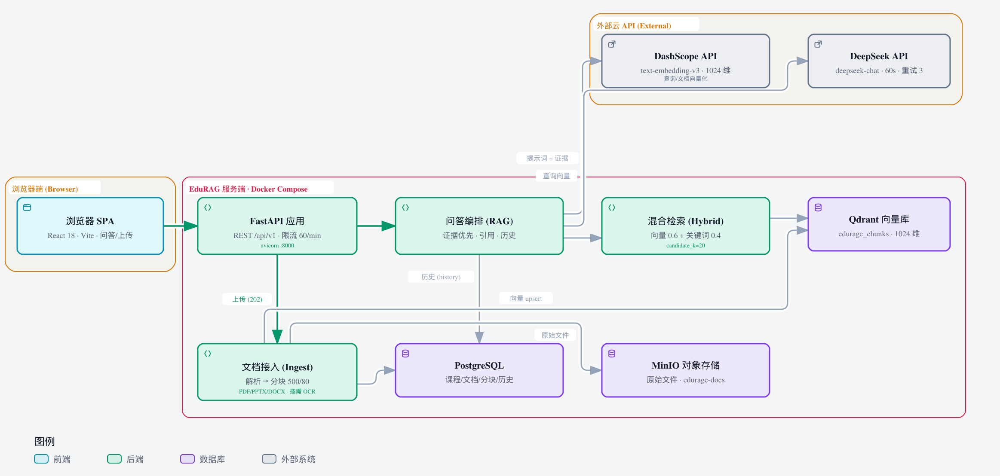

<h1 align="center">EduRAG</h1>

<p align="center">
  <strong>面向高校实验课的课程级 RAG 教学助手</strong><br/>
  上传课件 → 混合检索 → 带页码引用的 Markdown / LaTeX 回答
</p>

<p align="center">
  <a href="https://github.com/scoffee16/EduRAG/actions/workflows/ci.yml"></a>
  <a href="LICENSE"></a>
  
  
</p>

## 简介

EduRAG 是一个**可自托管的课程级 RAG 问答系统**：把 PDF / PPTX / DOCX 课件导入某一门课程后，学生可以用自然语言提问；系统先在该课程资料中做**向量 + 关键词混合检索**，再生成带**页码 / 幻灯片 / 章节**引用的 Markdown / LaTeX 回答。

回答优先来自课程资料；当课程资料检索不到相关片段时，按「Bing 网页搜索 → 模型通用知识」降级，并显式标注来源。适合课程组资料助手、实验课答疑与私有课件检索。

## 特性

- **课程域隔离**：资料按课程归属，提问可限定课程或若干文档。
- **混合检索**：Qdrant 向量召回 + 关键词打分（标识符 / 中文 n-gram），加权 RRF 融合后确定性重排。
- **可核验引用**：按「文档 + 页码 / 幻灯片 / 章节」去重，附原文片段、模态与 OCR 信息。
- **结构感知解析**：PDF / PPTX / DOCX 按页、幻灯片、标题层级解析；扫描版 PDF 可选择开启 Tesseract OCR。
- **异步导入**：上传立即返回 `202`，前端轮询展示 `parse → chunk → embed → store` 进度。
- **来源分层**：课程资料 / 网页搜索 / 模型通用知识，回答中固定标注。
- **完整生命周期**：文档与课程的创建、删除与级联清理，查询历史持久化。
- **开箱即用**：Docker Compose 一键启动 API、PostgreSQL、Qdrant 与 MinIO。

## 架构



React 18 + Vite 前端 → FastAPI `/api/v1` → 导入管线 / 混合检索 / 引用生成；数据落在 Qdrant（向量）、PostgreSQL（元数据与历史）、MinIO（原始文件），模型调用 DeepSeek Chat 与 DashScope `text-embedding-v3`。

> 可交互版本（缩放 / 深浅色）：[architecture.html](docs/assets/edurage-architecture.html) · 问答链路图：[rag-flow.png](docs/assets/edurage-rag-flow.png)

## 快速开始

**前置条件**：Docker + Docker Compose v2、Node.js 20+、DeepSeek 与 DashScope API Key。

```powershell
git clone https://github.com/scoffee16/EduRAG.git
cd EduRAG
Copy-Item .env.example .env    # 填入两个 API Key，并设置 EDURAGE_ALLOW_CLOUD_UPLOAD=true
docker compose up -d --build   # API :8000 + PostgreSQL + Qdrant + MinIO
```

```powershell
cd frontend
npm install
npm run dev                    # http://localhost:5173
```

- API 文档：<http://127.0.0.1:8000/docs>；健康检查：`curl.exe http://127.0.0.1:8000/api/v1/health`
- Windows 也可双击 `start_edurage.bat` 一键启动（首次使用前同样需要配置 `.env`）
- 本地开发（不用容器跑 API）：见 [docs/development.md](docs/development.md)

## 配置

运行时配置全部通过 `EDURAGE_*` 环境变量提供，共 42 项，完整清单见 [.env.example](.env.example)。最常改的几项：

| 变量 | 说明 |
| --- | --- |
| `EDURAGE_LLM_API_KEY` / `EDURAGE_EMBEDDING_API_KEY` | 必填：DeepSeek 对话 + DashScope 向量 |
| `EDURAGE_ALLOW_CLOUD_UPLOAD` | 上传开关，默认 `false`；改为 `true` 表示允许课件发往云 API |
| `EDURAGE_LLM_MODEL` / `EDURAGE_EMBEDDING_MODEL` | 模型名，默认 `deepseek-chat` / `text-embedding-v3` |
| `EDURAGE_OCR_ENABLED` | 扫描版 PDF OCR，默认关闭（需本机 Tesseract） |

> `.env` 已被 `.gitignore` 忽略，不会提交。Compose 会为 API 注入容器内部服务地址；`.env.example` 中的存储地址面向宿主机本地开发。

## API

接口统一以 `/api/v1` 为前缀，错误响应为 `{"error":{"code","message"},"request_id"}`：

- `POST /upload` 上传课件（异步）、`GET /documents` / `DELETE /documents/{id}` 文档管理
- `POST /query` 课程范围内问答，`GET /history` 查询历史
- `GET /courses` / `POST /courses` / `DELETE /courses/{code}` 课程管理
- `GET /health` / `GET /health/ocr` 健康检查

完整字段、错误码与限制见 [docs/ed-04-api.md](docs/ed-04-api.md)。

## 测试与评估

```powershell
python -m pip install -e ".[dev]"
python -m pytest -q                  # 316 项后端测试（离线）
python -m ruff check .
cd frontend; npm install; npm test   # 32 项前端测试
```

检索评估为确定性离线回归（8 题 golden set）：`python -m scripts.evaluate_retrieval --mode both`。当前代码上 Recall@5 从 `0.625` 提升到 `1.000`，MRR 从 `0.531` 提升到 `0.906`；指标定义见 [docs/ed-04-evaluation.md](docs/ed-04-evaluation.md)。

CI 包含 Python 3.11 / 3.12 / 3.13 后端测试、前端构建与测试、`docker compose config` 校验。

## 已知限制

- **仅适用于单机 / 受信内网**：没有账号、鉴权、CORS 与 TLS；Compose 默认数据库 / MinIO 凭据仅用于本地开发，生产部署前必须更换。
- **依赖第三方云 API**：默认使用 DeepSeek + DashScope，课件片段与问题会发送到对应服务，不支持离线推理。
- **异步导入非持久队列**：使用进程内 `BackgroundTasks`，重启可能中断任务；限流与并发控制仅对单进程生效，建议只跑一个 API worker。
- **引用粒度有限**：到页 / 幻灯片 / 章节；OCR 仅处理扫描版 PDF 页面；前端未容器化。
- **规划项未实现**：知识图谱、Agent 工具链、多模态 / 波形解析、Cross-Encoder 重排等。

## 文档

- [docs/development.md](docs/development.md) — 本地开发、Docker 流程、常见问题
- [docs/ed-04-api.md](docs/ed-04-api.md) — API 契约与限制
- [docs/ed-04-ingest.md](docs/ed-04-ingest.md) — 解析、分块、OCR 与元数据
- [docs/ed-04-evaluation.md](docs/ed-04-evaluation.md) — 检索评估方法与指标

## 贡献

欢迎通过 Issue 反馈问题、通过 PR 提交改进。提交前请运行 `python -m ruff check .` 与 `python -m pytest -q`，涉及前端时再运行 `npm run build` 与 `npm test`；CI 会在 Python 3.11 / 3.12 / 3.13 与 Node 上验证。

## 许可证

本项目以 [MIT License](LICENSE) 开源。

Copyright (c) 2026 EduRAG contributors
