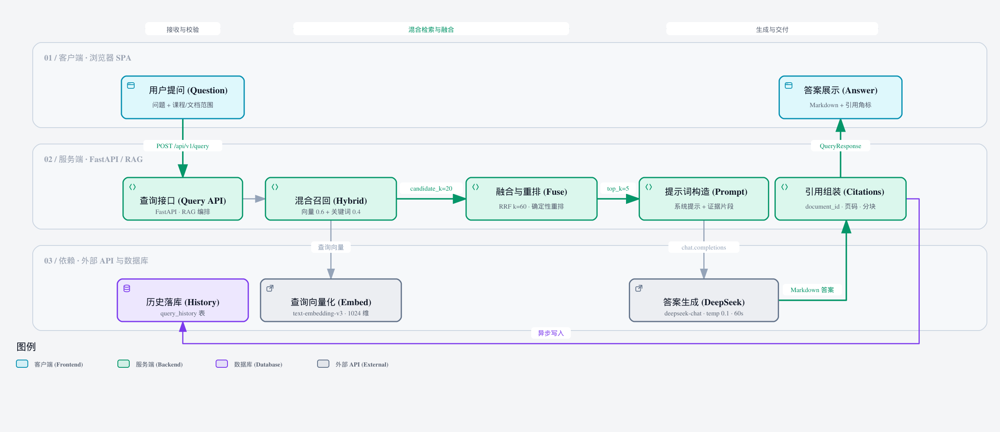

<h1 align="center">EduRAG</h1>

<p align="center">
  <strong>面向高校实验课的课程级 RAG 教学助手</strong><br/>
  上传课件 → 混合检索 → 带页码引用的 Markdown / LaTeX 回答
</p>

<p align="center">
  <a href="https://github.com/scoffee16/EduRAG/actions/workflows/ci.yml"></a>
  <a href="LICENSE"></a>
  
  
</p>

---

## 目录

- [项目简介](#项目简介)
- [功能特性](#功能特性)
- [系统架构](#系统架构)
- [一次提问的检索与生成链路](#一次提问的检索与生成链路)
- [快速开始](#快速开始)
- [配置说明](#配置说明)
- [API 概览](#api-概览)
- [项目结构](#项目结构)
- [测试与评估](#测试与评估)
- [已知限制与安全注意事项](#已知限制与安全注意事项)
- [文档](#文档)
- [贡献](#贡献)
- [许可证](#许可证)

---

## 项目简介

EduRAG 是一个**可自托管的课程级 RAG（检索增强生成）问答系统**，面向高校实验/实验类课程。把 PDF、PPTX、DOCX 课件导入某一门课程后，学生可以用自然语言提问；系统会先在该课程的资料中做**向量 + 关键词的混合检索**，再基于命中的文档片段生成带**页码 / 幻灯片号 / 章节**引用的 Markdown / LaTeX 回答。

与通用聊天机器人不同，EduRAG 的回答优先来自课程资料本身；当课程资料中检索不到任何相关片段时，它会按固定顺序降级并**显式标注来源**：

```text
课程资料（带引用）
  └─ 检索结果为 0 条 → Bing 网页搜索结果（附链接）
       └─ 仍无结果 → 模型通用知识（显式标注，非课程资料）
```

这让学生既能查课件细节，也能知道“答案到底来自哪里、可不可信”。

**适用场景**：课程组内部资料助手、实验课答疑、课件内容检索、私有课程资料问答。
**当前状态**：`0.0.1`，单机 / 受信内网可用；功能范围以本 README 列出的已实现能力为准，不含早期设计文档中的知识图谱、Agent 工具链等规划项。

## 功能特性

- **课程域隔离的混合检索**：每份资料归属一个课程，提问时可按课程或指定文档检索。Qdrant 向量召回候选集与关键词打分（标识符 + 中文 n-gram）通过加权 RRF 融合，再做确定性的启发式重排，最终取默认 `top_k=5`（请求可覆盖）送进模型。
- **可核验的引用**：回答附带引用列表，按 `(文档, 页码/幻灯片号/章节)` 去重，包含不超过 200 字的原文片段、模态（文本 / OCR / 混合）、是否使用 OCR 等信息。
- **结构感知的文档解析**：PDF 按页、PPTX 按幻灯片（含表格与备注）、DOCX 按标题层级解析；分块保留页码、章节、块类型（标题 / 表格 / 代码 / 图注 / 段落）等元数据。
- **可选的选择性 OCR**：开启 OCR 后，仅对扫描版 PDF 中文本过少（默认 <80 字符）或图片占比高且文本偏少（<160 字符）的页面调用 Tesseract（`chi_sim+eng`）识别，并与文本层合并；OCR 失败不会导致文档导入失败。
- **异步上传与进度**：`POST /upload` 立即返回 `202` 与 `document_id`，后台完成解析、分块、向量化、入库；前端轮询 `GET /documents/{id}` 展示 `parse → chunk → embed → store` 进度。
- **文档与课程生命周期**：文档列表、详情、删除（Postgres + Qdrant + MinIO 级联清理）；课程列表、手动建课、删除课程（支持强制级联删除）。
- **带来源分层的回答**：回答中确定性地标注知识来源（课程资料 / 网页搜索 / 模型通用知识），并返回 `knowledge_sources` 与 `web_results`。
- **查询历史**：已答问题持久化到 PostgreSQL，`GET /history` 按时间倒序返回问题、范围、引用快照等。
- **前端体验**：React 18 + Vite 6 单页应用，支持课程选择、上传与进度、多文档范围、Markdown/GFM/KaTeX 渲染、引用卡片、历史面板、OCR 状态提示与请求 ID 展示。
- **开箱即用的本地栈**：Docker Compose 一键启动 API + PostgreSQL + Qdrant + MinIO；Windows 提供 `start_edurage.bat` 一键脚本；测试与检索评估均可离线运行。

## 系统架构


> 可交互版本（可缩放、切换深浅色）：[docs/assets/edurage-architecture.html](docs/assets/edurage-architecture.html)

| 层 | 技术 | 职责 |
| --- | --- | --- |
| 前端 | React 18 + Vite 6 + TypeScript | 课程选择、课件上传与进度、问答、引用与历史展示；开发时由 Vite 代理 `/api` 到后端 |
| 后端 API | FastAPI + Pydantic v2 | `/api/v1` REST 接口、请求 ID、限流与并发控制、统一错误信封 |
| 导入管线 | PyMuPDF / python-pptx / python-docx / Tesseract | 解析 → 结构化分块 → 批量向量化 → 写对象存储与向量库 → 元数据入库 |
| 检索与生成 | 自研混合检索 + OpenAI 兼容客户端 | 向量 + 关键词融合、启发式重排、课程域过滤、来源分层与引用投影 |
| 向量库 | Qdrant 1.12 | 存放 1024 维文本向量与分块 payload，承载 ANN 检索 |
| 关系库 | PostgreSQL 16（pgvector 镜像） | 课程、文档、分块元数据与查询历史；启动时自动建表与增量迁移 |
| 对象存储 | MinIO | 保存上传的原始课件文件（按 `{课程}/{文档ID}/{文件名}` 组织） |
| 外部模型 | DeepSeek Chat / 阿里云百炼 DashScope | 对话生成与 `text-embedding-v3` 向量化（OpenAI 兼容接口，可替换 base URL 与模型） |

## 一次提问的检索与生成链路



> 可交互版本： [docs/assets/edurage-rag-flow.html](docs/assets/edurage-rag-flow.html)

1. **导入**：课件上传后，后台解析出带页码/章节信息的结构化分块；每块文本调用 embedding 接口得到默认 1024 维向量（由 `EDURAGE_EMBEDDING_DIM` 指定，需与模型一致），写入 Qdrant，同时把元数据写入 PostgreSQL，原始文件存入 MinIO。
2. **提问**：前端提交 `{question, course_code, document_ids?, top_k?}`，可限定课程或某几份文档。
3. **混合召回**：Qdrant 向量检索取 `candidate_k=20` 个候选；关键词通道在候选集和独立的 payload 扫描（默认上限 2000 条）上按标识符与中文 n-gram 打分。
4. **融合与重排**：两路结果用加权 RRF（默认向量 0.6 / 关键词 0.4，k=60）融合，再经确定性启发式重排，取 `top_k` 片段。
5. **生成**：把命中片段连同页码、来源标注写入中文 Prompt，调用 DeepSeek Chat 生成 Markdown/LaTeX 回答；模型调用对 429/5xx/超时做重试（最多 3 次尝试）。
6. **来源判定与引用**：当课程资料检索结果为 0 条时，按「网页搜索 → 模型通用知识」降级，并固定标注来源；若检索命中课程资料但信息不足，模型可能追加显式标注的「补充说明（模型通用知识）」，此时 `knowledge_sources` 仍为 `course_materials`。引用按文档与页去重后返回。
7. **留痕**：问题、检索范围、引用快照写入 `query_history`，前端可查看历史。

## 快速开始

### 前置条件

| 依赖 | 说明 |
| --- | --- |
| Docker Engine + Docker Compose v2 | 推荐 Docker Desktop（Windows / macOS） |
| Node.js 20+ 与 npm（CI 使用 Node 24） | 运行前端开发服务器 |
| DeepSeek API Key | 对话模型 `deepseek-chat` |
| 阿里云百炼 DashScope API Key | 向量模型 `text-embedding-v3` |
| Tesseract 5 + `chi_sim` 语言包（可选） | 仅在启用扫描版 PDF OCR 时需要 |

> 两个模型接口均为 OpenAI 兼容协议，你可以通过 `EDURAGE_LLM_BASE_URL` / `EDURAGE_LLM_MODEL`、
> `EDURAGE_EMBEDDING_BASE_URL` / `EDURAGE_EMBEDDING_MODEL` 替换为其他兼容服务（向量维度需保持 1024）。

### 1. 获取代码并准备配置

```powershell
git clone https://github.com/scoffee16/EduRAG.git
cd EduRAG
Copy-Item .env.example .env     # macOS / Linux: cp .env.example .env
```

编辑 `.env`，至少完成以下设置：

```dotenv
# 两个必填密钥
EDURAGE_LLM_API_KEY=你的 DeepSeek API Key
EDURAGE_EMBEDDING_API_KEY=你的 DashScope API Key

# 上传开关：默认 false 时 POST /upload 返回 403 upload_disabled。
# 改为 true 表示你确认课件内容允许发送给第三方 embedding / LLM 服务。
EDURAGE_ALLOW_CLOUD_UPLOAD=true
```

> `.env` 已被 `.gitignore` 忽略，请勿提交；`.env.example` 中的存储地址默认指向宿主机
> `127.0.0.1`（供本地开发与初始化脚本使用），Docker Compose 会为 API 注入容器内部的服务地址，无需修改。

### 2. 启动后端与基础设施

```powershell
docker compose up -d --build
```

首次启动时，API 会自动建表、应用增量迁移并同步示例课程包 `CS-COMP-ORG`（计算机组成原理示例课程）；Qdrant 集合在第一次导入文档时自动创建。

验证服务：

```powershell
curl.exe http://127.0.0.1:8000/api/v1/health
# {"status":"ok","service":"edurage","version":"0.0.1"}
```

- API 文档（Swagger UI）：<http://127.0.0.1:8000/docs>
- OpenAPI JSON：<http://127.0.0.1:8000/openapi.json>

> Windows 用户也可以直接双击 `start_edurage.bat`（需要 Docker Desktop、Node.js；脚本为 GBK + CRLF 编码）。
> 它会启动后端栈、打开日志窗口、启动前端并自动打开浏览器；首次使用前同样需要先创建并填写 `.env`。

### 3. 启动前端

```powershell
cd frontend
npm install
npm run dev
```

打开 <http://localhost:5173>。前端开发服务器会把 `/api` 代理到 `http://127.0.0.1:8000`（可用 `EDURAGE_API_PROXY` 覆盖）。

### 4. 导入课件并提问

在页面中选择课程 → 上传 PDF/PPTX/DOCX（默认大小上限 20 MB）→ 等待状态变为 `indexed` → 输入问题。

也可以直接调用 API：

```powershell
# 上传（返回 202 与 document_id）
curl.exe -X POST http://127.0.0.1:8000/api/v1/upload `
  -F "file=@D:\path\to\lecture.pdf;type=application/pdf" `
  -F "course_code=CS-COMP-ORG"

# 轮询导入状态（PowerShell 中 < > 是保留字符，需把文档 ID 放进变量）
$DOC_ID = "<document_id>"
curl.exe "http://127.0.0.1:8000/api/v1/documents/$DOC_ID"

# 提问（PowerShell 下用 Invoke-RestMethod 传递中文 JSON，避免代码页乱码）
$body = @{ question = "ADD 指令的微地址序列是什么？"; course_code = "CS-COMP-ORG"; top_k = 5 } | ConvertTo-Json
Invoke-RestMethod -Method Post -Uri "http://127.0.0.1:8000/api/v1/query" -ContentType "application/json; charset=utf-8" -Body $body
```

### 其他运行方式

**本地开发（不用容器跑 API）**

```powershell
# 1) 只启动基础设施
docker compose up -d postgres qdrant minio

# 2) 安装后端依赖
python -m venv .venv
.\.venv\Scripts\Activate.ps1
python -m pip install -e ".[dev]"

# 3) 可选：显式初始化表结构 / Qdrant 集合（两者均幂等，API 启动也会自动建表）
python scripts/init_db.py
python scripts/init_qdrant.py

# 4) 启动热重载开发服务器（默认 0.0.0.0:8000，可用 -BindHost / -Port 修改）
.\scripts\dev.ps1
```

macOS / Linux 使用 `source .venv/bin/activate`、`bash scripts/dev.sh`；更多细节见 [docs/development.md](docs/development.md)。

**启用 OCR（可选）**

```powershell
python -m pip install -e ".[dev,ocr]"
# 另需安装 Tesseract 5 与 chi_sim 语言包，并保证 tesseract 在 PATH 中（或用 EDURAGE_OCR_TESSERACT_CMD 指定路径）
$env:EDURAGE_OCR_ENABLED="true"    # 持久化则写入 .env
```

OCR 仅作用于**扫描版 PDF 页面**（文本 <80 字符，或图片占比 ≥35% 且文本 <160 字符的页）；可用 `GET /api/v1/health/ocr` 查看就绪状态。

## 配置说明

所有运行时配置都通过 `EDURAGE_*` 环境变量提供，完整清单（42 项）见 [.env.example](.env.example)，并由 `tests/test_env_contract.py` 冻结。常用配置如下：

| 分类 | 变量 | 默认值（`.env.example`） | 说明 |
| --- | --- | --- | --- |
| 对话模型 | `EDURAGE_LLM_MODEL` | `deepseek-chat` | OpenAI 兼容对话模型 |
| | `EDURAGE_LLM_BASE_URL` | `https://api.deepseek.com` | 对话接口地址 |
| | `EDURAGE_LLM_API_KEY` | — | **必填** |
| 向量模型 | `EDURAGE_EMBEDDING_MODEL` | `text-embedding-v3` | 需输出 1024 维向量 |
| | `EDURAGE_EMBEDDING_BASE_URL` | DashScope 兼容地址 | 向量接口地址 |
| | `EDURAGE_EMBEDDING_API_KEY` | — | **必填** |
| | `EDURAGE_EMBEDDING_DIM` | `1024` | 向量维度，需与模型一致 |
| 存储 | `EDURAGE_QDRANT_URL` | `http://127.0.0.1:6333` | 宿主机开发地址；Compose 内部为 `qdrant:6333` |
| | `EDURAGE_POSTGRES_DSN` | `postgresql+psycopg://...@127.0.0.1:5432/edurage` | 同上 |
| | `EDURAGE_MINIO_ENDPOINT` | `127.0.0.1:9000` | 同上 |
| 隐私开关 | `EDURAGE_ALLOW_CLOUD_UPLOAD` | `false` | 为 `false` 时上传接口返回 403；不控制问答时的云端调用 |
| 检索 | `EDURAGE_TOP_K` | `5` | 最终送进模型的片段数 |
| | `EDURAGE_CANDIDATE_K` | `20` | 向量召回候选数 |
| | `EDURAGE_VECTOR_WEIGHT` / `EDURAGE_KEYWORD_WEIGHT` | `0.6` / `0.4` | 混合检索权重 |
| | `EDURAGE_CHUNK_SIZE` / `EDURAGE_CHUNK_OVERLAP` | `500` / `80` | 分块长度与重叠 |
| 限额 | `EDURAGE_UPLOAD_MAX_MB` | `20` | 单文件大小上限 |
| | `EDURAGE_API_RATE_LIMIT_PER_MINUTE` | `60` | 单进程每分钟请求数（健康检查除外） |
| | `EDURAGE_API_MAX_CONCURRENCY` | `2` | 单进程并发上限，超出返回 503 |
| OCR | `EDURAGE_OCR_ENABLED` | `false` | 扫描版 PDF 页 OCR 开关 |
| | `EDURAGE_OCR_LANGUAGE` | `chi_sim+eng` | Tesseract 语言 |

> 说明：表中「默认值」取自 `.env.example`（面向宿主机开发）。代码内置默认在未创建 `.env` 时指向 Compose 服务名（如 `qdrant:6333`）；Compose 会为 API 固定注入容器内部地址，因此两种启动方式都无需手工改存储地址。
>
> 少数环境变量目前仅作为契约保留（例如 `*_PROVIDER`、`EDURAGE_API_HOST`/`EDURAGE_API_PORT`、
> `EDURAGE_LLM_TEMPERATURE`），不会改变运行时行为；以代码实际行为为准。

## API 概览

所有接口以 `/api/v1` 为前缀，错误响应统一为 `{"error":{"code","message"},"request_id"}`，响应头回显 `X-Request-ID`。

| 方法 | 路径 | 说明 |
| --- | --- | --- |
| GET | `/health` | 存活检查（不探测依赖） |
| GET | `/health/ocr` | OCR 就绪状态：`ok` / `disabled` / `unavailable` |
| POST | `/upload` | 上传课件（PDF/PPTX/DOCX，multipart），`202` 异步处理 |
| GET | `/documents` | 文档列表，可按 `course_code` 过滤 |
| GET | `/documents/{document_id}` | 文档详情、状态与导入进度 |
| DELETE | `/documents/{document_id}` | 删除文档及其向量、原始文件 |
| POST | `/query` | 课程范围内的问答，返回回答、引用与来源 |
| GET | `/history` | 最近问答历史（默认 20 条，最多 50 条） |
| GET | `/courses` | 课程列表（含来源、文档数、分块数） |
| POST | `/courses` | 手动创建课程 |
| DELETE | `/courses/{course_code}` | 删除课程，`force=true` 级联删除文档与向量 |

课程包保存在 `configs/course_packs/*.yaml`，API 启动时自动同步；示例课程 `CS-COMP-ORG` 由 `comp_org.yaml` 定义，`origin=config` 的课程不能通过 API 删除。当前解析器按文件类型固定分发（PDF/PPTX/DOCX），课程包中的 `parsers` / `knowledge_graph` / `tools` / `retrieval_config` 字段为未来扩展预留，当前运行时不执行。接口契约细节见 [docs/ed-04-api.md](docs/ed-04-api.md)。

## 项目结构

```text
EduRAG/
├─ src/edurage/
│  ├─ api/v1/endpoints/        # 上传、问答、文档、课程、历史、健康检查
│  ├─ ingest/                  # PDF/PPTX/DOCX 解析、OCR、结构化分块、向量化、索引
│  ├─ rag/                     # 混合检索、重排、Prompt、来源分层、引用、网页检索
│  ├─ courses/                 # 课程包 schema、加载与启动同步
│  ├─ db/  vector/  storage/   # PostgreSQL / Qdrant / MinIO 适配
│  └─ core/                    # 配置、日志等基础设施
├─ frontend/                   # React 18 + Vite 6 + TypeScript 单页应用
├─ configs/course_packs/       # 课程包 YAML（示例：CS-COMP-ORG）
├─ docker/                     # API 镜像与 PostgreSQL 初始化 SQL
├─ docs/                       # 开发、API、导入、评估文档；assets/ 存放架构图
├─ scripts/                    # 开发服务器、初始化、本地导入、检索评估
├─ tests/                      # 后端测试（316 项，离线运行）
├─ docker-compose.yml          # API + PostgreSQL + Qdrant + MinIO
├─ .env.example                # 42 项环境变量契约
├─ pyproject.toml              # 后端依赖与工具配置
├─ start_edurage.bat           # Windows 一键启动脚本（可选）
└─ LICENSE                     # MIT
```

## 测试与评估

后端测试为离线测试，使用 fakes / 本地哈希向量，不需要 API Key 或外部服务。首次运行先安装依赖：`python -m pip install -e ".[dev]"`；前端测试先执行 `cd frontend` 与 `npm install`。

```powershell
python -m pytest -q            # 316 项后端测试
python -m ruff check .         # 静态检查
cd frontend; npm test          # 32 项前端 Vitest 测试
```

CI（GitHub Actions）包含三个任务：Python 3.11 / 3.12 / 3.13 的 lint + pytest、前端构建与测试、`docker compose config` 校验。

**检索评估**（确定性、离线，基于 8 题 golden set 回归夹具）：

```powershell
python -m scripts.evaluate_retrieval --mode both
```

2026-10-22 在仓库当前代码上复现的结果：

| 指标 | 仅向量候选 | 加入独立关键词候选 |
| --- | --- | --- |
| Recall@5 | 0.625 | **1.000** |
| MRR | 0.531 | **0.906** |

该夹具用于防止检索链路回归，题量很小，不代表真实课程上的绝对效果；指标定义与测试集见 [docs/ed-04-evaluation.md](docs/ed-04-evaluation.md)。

## 已知限制与安全注意事项

EduRAG 目前定位为**单机 / 受信内网**工具，上生产前请务必了解：

- **没有账号体系、鉴权、CORS 与 TLS**：所有接口默认对能访问该端口的人开放。若要对公网暴露，请在前置反向代理层增加认证、HTTPS 与访问控制。
- **开发凭据是固定值**：Compose 内 PostgreSQL 默认 `edurage/edurage`，MinIO 使用 `.env.example` 中的占位密钥。端口已绑定 `127.0.0.1`，但在共享或生产环境部署前必须更换数据库与 MinIO 凭据（PostgreSQL 需同步修改 Compose 与 `EDURAGE_POSTGRES_DSN`）。
- **推理依赖第三方云 API**：对话走 DeepSeek、向量化走 DashScope，课件分块内容与问答内容会发送到对应服务；项目当前**不支持离线推理**。`EDURAGE_ALLOW_CLOUD_UPLOAD` 只是上传接口的隐私开关。
- **异步导入不是持久队列**：上传使用进程内 `BackgroundTasks`，服务重启可能让文档停留在 `processing`；限流与并发控制也只对单进程生效。部署时建议只跑一个 API worker。
- **前端未容器化**：Compose 只包含 API 与基础设施。生产环境请 `npm run build` 后将静态文件交由反向代理托管，并把 `/api` 转发到后端。
- **引用粒度有限**：引用到页 / 幻灯片 / 章节，不支持图、表行、代码行或区域坐标；OCR 仅针对扫描版 PDF 页面，PPTX/DOCX 内嵌图片不做 OCR。
- **检索评估样本很小**：评估夹具仅 8 题，用于回归而非效果承诺。
- **课程包扩展字段尚未生效**：`parsers` / `knowledge_graph` / `tools` / `retrieval_config` 仅为预留元数据；知识图谱、Agent 工具链、图像/波形多模态解析、Cross-Encoder/LLM 重排、离线本地模型等均未实现。
- **pgvector 仅作 schema 预留**：向量检索全部由 Qdrant 承担，PostgreSQL 中向量以 JSON 存储，不使用 pgvector ANN。
- **查询历史无清理机制、无用户身份**：所有问答记录会持续累积。
- **Windows 脚本编码特殊**：`start_edurage.bat` / `scripts/logs.bat` 必须保持 GBK + CRLF；仓库通过 `.gitattributes` 保证检出时换行正确。

## 文档

| 文档 | 内容 |
| --- | --- |
| [docs/development.md](docs/development.md) | 本地开发、环境搭建、Docker 流程、常见问题 |
| [docs/ed-04-api.md](docs/ed-04-api.md) | API 契约、字段、错误码与限制 |
| [docs/ed-04-ingest.md](docs/ed-04-ingest.md) | 解析、分块、OCR 与元数据说明 |
| [docs/ed-04-evaluation.md](docs/ed-04-evaluation.md) | 检索评估方法与指标定义 |

## 贡献

欢迎通过 Issue 反馈问题、通过 Pull Request 提交改进。提交前请确保：

```powershell
python -m ruff check .
python -m pytest -q
```

并在涉及前端时运行 `npm run build` 与 `npm test`。CI 会在 Python 3.11 / 3.12 / 3.13 与 Node 上验证这些检查。

## 许可证

本项目以 [MIT License](LICENSE) 开源。

Copyright (c) 2026 EduRAG contributors
